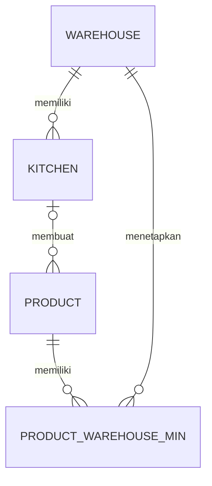
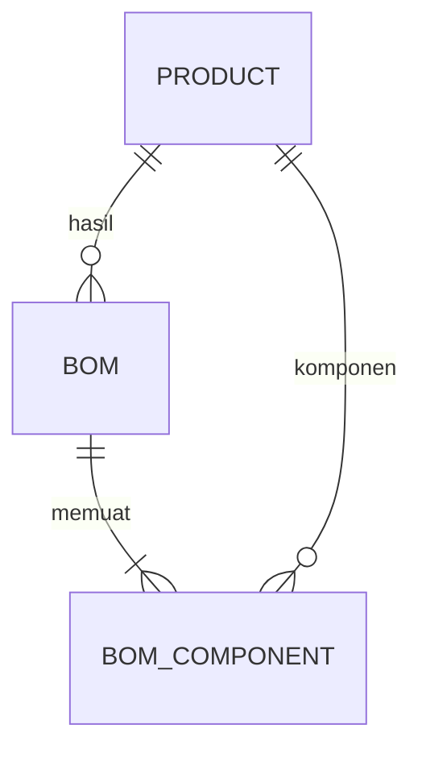
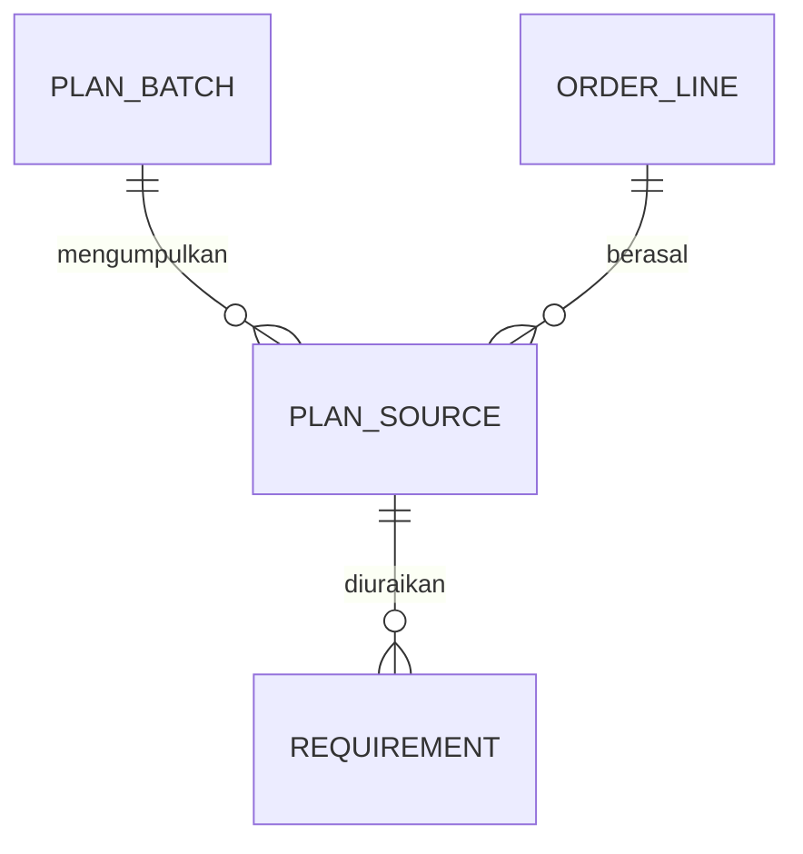
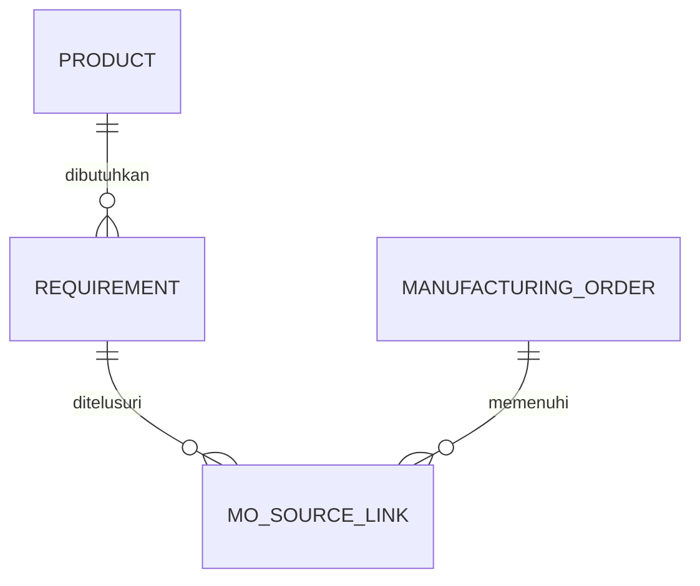
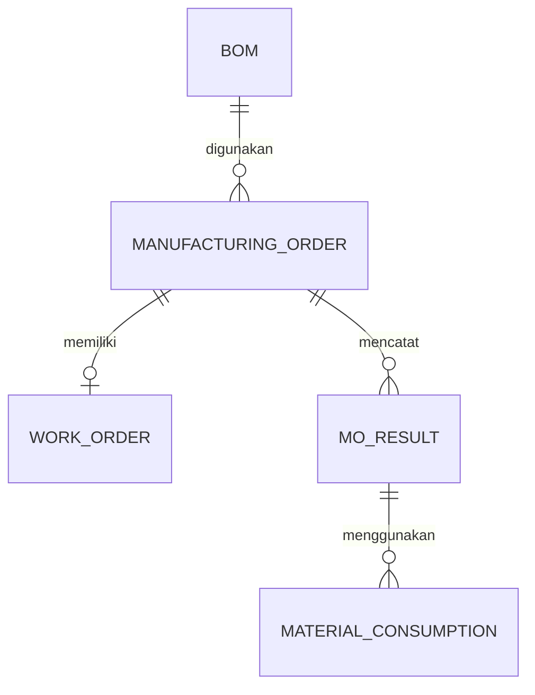
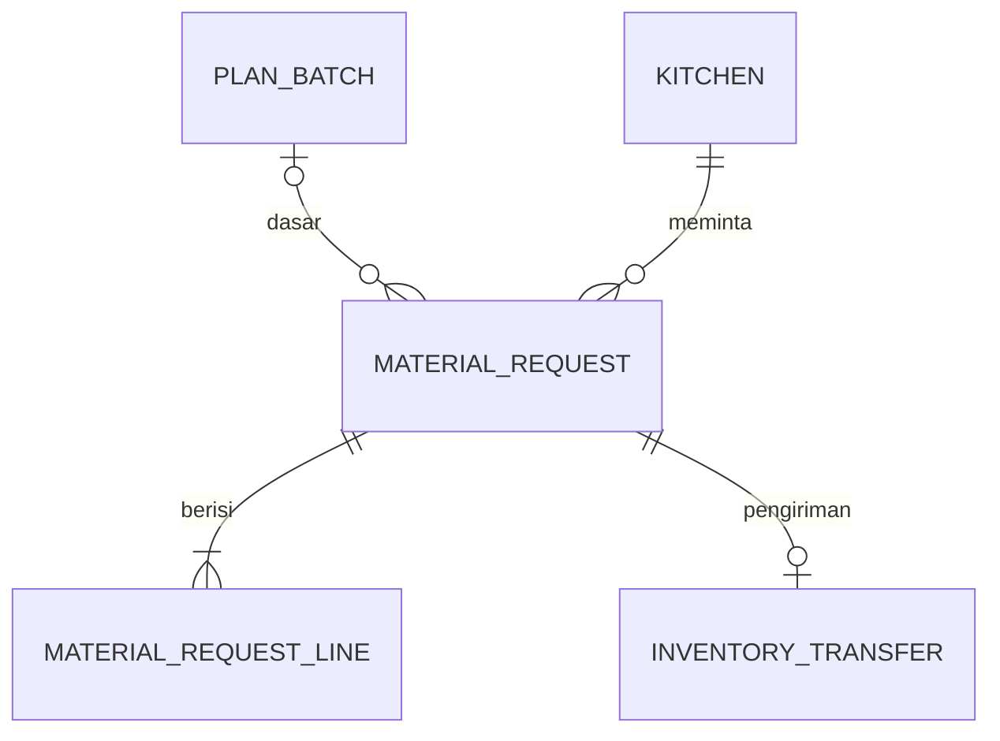
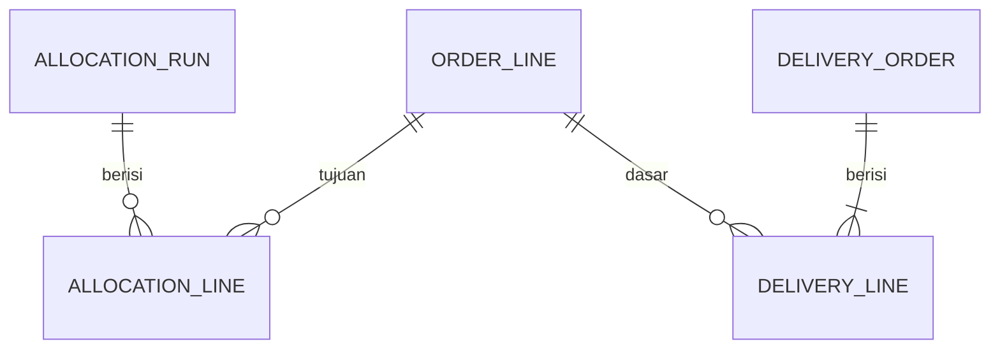
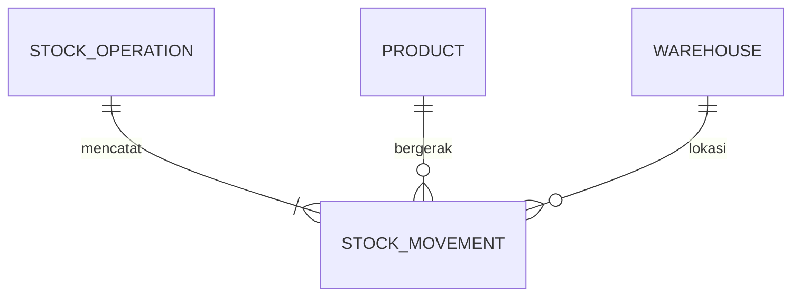

# ERD — Modul Manufakturing dan Integrasi Inventori

**Versi:** 1.0 — rancangan logis untuk ditinjau Feri  
**Tanggal:** 29 Oktober 2026  
**Pasangan dokumen:** [PRD_Manufakturing_v1.md](PRD_Manufakturing_v1.md)

ERD ini menjelaskan **hubungan data yang diperlukan**, bukan daftar tabel yang sudah ada dan bukan perintah migrasi. Kode repository `app-erp` yang diperiksa menyimpan data operasional sebagai JSON ber-versi dalam `app_state`; `users` tersimpan terpisah. Entitas di bawah dapat dipetakan ke objek JSON, tabel relasional, atau gabungan yang dirancang kemudian. Pilihan penyimpanan harus menjaga satu sumber kebenaran stok.

Diagram dibagi menurut proses agar mudah dibaca. `PK` berarti identitas logis; `FK` menunjukkan hubungan yang perlu dijaga, bukan klaim adanya foreign key database pada aplikasi saat ini. Nama entitas berbahasa Inggris adalah usulan teknis, bukan nama layar yang wajib dipakai.

## 1. Peta entitas dan asalnya

| Entitas logis | Makna dan posisi saat ini |
|---|---|
| `PRODUCT`, `WAREHOUSE`, `KITCHEN`, `BOM`, `BOM_COMPONENT`, `USER` | Master yang sudah memiliki representasi dalam aplikasi yang diperiksa. Relasi produk → dapur dan pemilihan BOM otomatis perlu dicocokkan dengan kebutuhan baru. |
| `PRODUCT_WAREHOUSE_MIN` | Pengaturan minimum per barang per gudang yang dibutuhkan. Aplikasi saat ini masih memakai `minCentral` dan `minBranch`, bukan nilai terpisah untuk setiap gudang. |
| `ORDER_LINE` | Referensi logis baris RO toko atau SO. Sumber RO/SO yang akan digunakan harus ditetapkan; ini bukan klaim bahwa kedua modul sudah ada di aplikasi yang diperiksa. |
| `PLAN_BATCH`, `PLAN_SOURCE`, `REQUIREMENT`, `MO_SOURCE_LINK` | Kelompok rencana dan penelusuran kebutuhan dari sumber ke produk yang perlu dibuat. Struktur adalah usulan untuk menjaga asal RO/SO saat jumlah direkap. |
| `MANUFACTURING_ORDER`, `WORK_ORDER`, `MO_RESULT`, `MATERIAL_CONSUMPTION` | Data MO/WO, hasil dan konsumsi yang dibutuhkan. Aplikasi telah memiliki objek `productions`, tetapi belum boleh dianggap sama persis dengan model ini. |
| `MATERIAL_REQUEST`, `MATERIAL_REQUEST_LINE` | Permintaan multi-SKU dari Admin Produksi untuk satu dapur, termasuk saran dan jumlah yang diminta. Dapat berdiri sendiri untuk buffer. |
| `INVENTORY_TRANSFER`, `STOCK_BATCH`, `STOCK_MOVEMENT` | Transfer, saldo dan riwayat pergerakan inventori yang sudah mempunyai representasi pada aplikasi yang diperiksa. Perlu diperluas/dihubungkan sesuai alur baru, bukan digandakan sembarangan. |
| `STOCK_OPERATION` | Kelompok logis pergerakan yang harus dibukukan secara konsisten. Dapat dipetakan ke transaksi/referensi yang ada; tidak mensyaratkan tabel fisik baru. |
| `ALLOCATION_RUN`, `ALLOCATION_LINE`, `DELIVERY_ORDER`, `DELIVERY_LINE`, `DELIVERY_SESSION` | Data alokasi dan batas integrasi DO/jadwal. Sumber dan implementasi DO yang akan digunakan belum diverifikasi pada aplikasi yang diperiksa. |
| `PURCHASE_ORDER`, `PURCHASE_ORDER_LINE` | Batas integrasi PO supplier yang sudah memiliki representasi di aplikasi. Penerimaan supplier ke Packing menggunakan stok inventori yang sama. |

## 2. Master produk, dapur dan minimum

- Satu dapur terkait gudang dapurnya. Satu dapur dapat membuat banyak produk.
- Setiap produk buatan dapur memiliki **satu dapur pembuat** pada master. Produk supplier dan SKU paket tidak harus memiliki dapur pembuat; perakitan paket berlangsung di Packing.
- `PRODUCT_WAREHOUSE_MIN` mewakili nilai minimum untuk satu pasangan barang–gudang. Nilai dapat berbeda antar gudang dan dapat diubah petugas. Minimum adalah parameter saran, bukan saldo yang diblokir.
- Model tidak mengasumsikan semua gudang non-Central memiliki nilai minimum yang sama. Cara mengalihkan nilai `minCentral`/`minBranch` lama ke konfigurasi baru masih perlu direncanakan agar data lama tidak hilang.

## 3. BOM produk dan BOM paket

| Entitas | Atribut logis penting |
|---|---|
| `BOM` | `bom_id` PK, `output_product_id` FK, `yield_qty`, `yield_uom`, status, konteks dapur/Packing bila dibutuhkan, identitas versi/riwayat bila dipilih. |
| `BOM_COMPONENT` | `bom_component_id` PK, `bom_id` FK, `component_product_id` FK, `qty_per_yield`, `uom`. |

Untuk produk dapur, petugas memilih produk pada MO dan sistem menentukan BOM yang berlaku. Kriteria bila beberapa BOM berlaku belum diputuskan. Untuk paket, BOM normal berisi produk-produk yang dirakit menjadi satu SKU paket di Packing; MO perakitan tidak memiliki WO. BOM hanya daftar komponen, sedangkan pergerakan stok terjadi ketika proses perakitan dibukukan.

Rancangan disarankan menyimpan acuan atau snapshot BOM/kuantitas pada MO agar perubahan master di kemudian hari tidak diam-diam mengubah riwayat. Bentuk versi/snapshot belum diputuskan.

## 4. Sumber kebutuhan, konsolidasi dan ketertelusuran

| Entitas | Atribut logis penting |
|---|---|
| `ORDER_LINE` | Identitas sumber, tipe `RO`/`SO`, referensi dokumen dan baris sumber, produk/paket, kuantitas, satuan, toko/customer dan tanggal yang relevan. Dapat menjadi referensi ke modul lain, tidak harus tabel salinan. |
| `PLAN_BATCH` | `plan_id` PK, label kelompok kebutuhan yang dikerjakan bersama, tanggal rencana/kirim yang relevan, status dan pembuat. Tanggal label shift belum diputuskan. |
| `PLAN_SOURCE` | `plan_source_id` PK, `plan_id` dan referensi `ORDER_LINE`, kuantitas sumber yang ikut kelompok. Menjaga hubungan meski beberapa sumber digabung. |
| `REQUIREMENT` | `requirement_id` PK, `plan_source_id`, `product_id`, jumlah/satuan, jenis kebutuhan langsung atau komponen paket, serta asal BOM paket jika relevan. |
| `MO_SOURCE_LINK` | `mo_id`, `requirement_id`, kuantitas rencana yang dikaitkan. Hubungan banyak-ke-banyak menjaga penelusuran dari MO ke masing-masing RO/SO. |

**Contoh:** RO toko A 100 unit Produk A dan SO 100 Paket P yang masing-masing membutuhkan 1 A menghasilkan kebutuhan A total 200 untuk kelompok yang dikerjakan bersama. Satu MO dapur A berjumlah 200 memiliki tautan ke kedua sumber; paket P juga mempunyai kebutuhan perakitan tersendiri di Packing. Hubungan perencanaan ini tidak otomatis membuat MO turunan atau WO bertingkat.

Kebutuhan paket diturunkan dari BOM untuk membantu perencanaan. Itu **tidak berarti** komponen atau paket sudah menjadi stok Packing saat SO/RO dibuat. Produk supplier untuk isi paket mengikuti PO, sedangkan produk setengah jadi tetap mengikuti buffer dan MO/WO manualnya sendiri.

## 5. MO, WO, hasil dan konsumsi

| Entitas | Atribut logis penting |
|---|---|
| `MANUFACTURING_ORDER` | `mo_id` PK, nomor, jenis `dapur`/`perakitan_packing`, produk hasil, `bom_id`, kuantitas rencana dan satuan, gudang/lokasi, kelompok rencana bila terkait, status, waktu dan petugas. MO manual untuk buffer boleh tanpa kelompok RO/SO. |
| `WORK_ORDER` | `wo_id` PK, `mo_id` FK, kuantitas WO, status dan catatan waktu pelaksanaan fisik serta pencatatan. Untuk MO dapur terdapat satu WO sebagai acuan satu kali produksi; MO Packing tidak memiliki WO. |
| `MO_RESULT` | `result_id` PK, `mo_id` FK, `wo_id` bila ada, jumlah rencana, jumlah hasil baik aktual, jumlah kurang yang dianggap rusak, jumlah lebih, waktu dibukukan dan petugas. Hasil baik tidak dikurangi dua kali oleh selisih rusak. |
| `MATERIAL_CONSUMPTION` | `consumption_id` PK, `result_id`, produk bahan, kuantitas dan satuan, referensi pergerakan stok/batch yang digunakan. Untuk WO dapur, dasar jumlahnya adalah **kuantitas WO dan BOM**, bukan hasil baik. |

Untuk satu WO dapur yang meminta 100 dan menghasilkan 95 baik, `MO_RESULT` mencatat 95 baik dan selisih 5 dianggap rusak; konsumsi tetap berdasarkan WO 100. Tidak dibuat backorder atau MO pengganti untuk kekurangan WO. Nilai lebih besar dari rencana merupakan kelebihan produksi.

`MO_RESULT` dihubungkan ke MO, bukan mewajibkan WO, agar MO perakitan Packing dapat dicatat tanpa WO. Detail apakah perakitan dicatat dalam satu atau beberapa tahap belum ditetapkan; jangan menerapkan aturan tambahan dari diagram ini. Waktu input hasil dapat berbeda dari waktu produksi fisik.

## 6. Permintaan bahan dari dapur dan transfer Central

| Entitas | Atribut logis penting |
|---|---|
| `MATERIAL_REQUEST` | `request_id` PK, nomor, dapur/gudang tujuan, Central sebagai sumber, `plan_id` opsional, status, waktu dan petugas. Referensi rencana kosong bila permintaan dibuat untuk buffer tanpa WO. |
| `MATERIAL_REQUEST_LINE` | `request_line_id` PK, `request_id`, produk dan satuan, total kebutuhan WO, stok yang dipakai dalam perhitungan, minimum, saran sistem, jumlah akhir yang diminta petugas. |
| `INVENTORY_TRANSFER` | Referensi transfer inventori yang ada beserta sumber, tujuan, status, dan baris-baris barang. Dalam alur normal satu permintaan/kelompok dapur menghasilkan satu pengiriman multi-SKU dan satu picking list. |

Saran dasar: `maksimum(0, kebutuhan WO + minimum − stok tersedia)`. Contoh 15 + 5 − 7 = **13**. Jika petugas mengubah menjadi 10, `jumlah akhir yang diminta` adalah 10 dan picking list menggunakan 10. Angka minimum tetap boleh dipakai sampai stok nol. Perlakuan kiriman dalam perjalanan dan komitmen lain belum diputuskan.

Diagram menunjukkan pengiriman utama untuk alur normal, bukan keputusan baru tentang penanganan pembatalan atau kebutuhan setelah transfer dikirim. Petugas Central memproses transfer sesuai kewenangan gudang sumber. Dapur → Packing adalah transfer langsung berbeda, tanpa request Central dan tanpa penerimaan terpisah.

## 7. Alokasi, DO dan jadwal pengiriman

| Entitas | Atribut logis penting |
|---|---|
| `ALLOCATION_RUN` | `allocation_id` PK, kelompok/tanggal rencana, produk atau tahap terkait, stok dasar yang dipakai, status, waktu dan petugas. Ini rencana pembagian, bukan pergerakan fisik. |
| `ALLOCATION_LINE` | `allocation_line_id` PK, `allocation_id`, referensi `ORDER_LINE`, produk, permintaan, prioritas SO/RO, jumlah usulan, jumlah yang ditetapkan petugas. |
| `DELIVERY_ORDER` | `do_id` PK atau referensi ke sistem DO, jenis SO/toko, referensi dokumen sumber, tanggal dan `session_id` opsional, status, waktu dan petugas. DO SO dapat terbentuk saat SO dikonfirmasi, sebelum alokasi dan ketersediaan fisik. |
| `DELIVERY_LINE` | `do_line_id`, `do_id`, referensi `ORDER_LINE`, produk atau SKU paket utuh, satuan dan jumlah. Untuk DO SO, jumlah per item sesuai SO; pembuatan/cetak DO tidak sama dengan pengiriman. |
| `DELIVERY_SESSION` | Identitas tanggal/sesi, waktu yang dapat diubah dan referensi jadwal. Ada tiga sesi harian; jadwal ke semua toko setiap hari tidak berarti setiap toko berada pada ketiga sesi. Pengiriman tidak otomatis berpindah hari dari tanggal kirim. |

Kebutuhan SO didahulukan; sisa untuk toko disarankan proporsional dengan RO dan dapat diubah petugas. Contoh RO 40/60 dan sisa 50 → usulan 20/30. Jika SO adalah paket, kebutuhan komponennya ikut prioritas saat perencanaan/perakitan. Kaitan antara alokasi komponen dan alokasi paket harus menjaga agar kebutuhan yang sama tidak dihitung dua kali.

DO SO disiapkan terlebih dahulu dan dicetak ketika siap; DO toko dibuat setelahnya. Prioritas ketika stok tidak memenuhi seluruh SO dan cara pembulatan proporsi belum ditetapkan. Stok aktual diperiksa ketika pengiriman dibukukan.

## 8. Pergerakan stok dan konsistensi

| Entitas | Atribut logis penting |
|---|---|
| `STOCK_OPERATION` | Identitas/ref transaksi, jenis dan sumber MO/transfer/DO/penerimaan PO, waktu dan pelaku. Ini pengelompokan logis; dapat memanfaatkan referensi inventori yang ada. |
| `STOCK_MOVEMENT` | Identitas, operasi, produk, gudang/lokasi, jumlah bertanda masuk/keluar, satuan, referensi batch bila digunakan, waktu dan referensi dokumen. Mapping harus menggunakan ledger inventori yang menjadi sumber kebenaran. |
| `STOCK_BATCH` | Saldo inventori per produk/gudang dan rincian batch/rak yang sudah ada pada aplikasi. ERD ini tidak mengubah kebijakan batch, expired, FIFO, valuasi atau data lama. |

Konsep saldo gudang adalah hasil dari data inventori yang sah; jangan membangun salinan saldo terpisah tanpa mekanisme konsistensi. MO dapur, MO perakitan, transfer dan DO mengacu pada operasi/ledger inventori yang sama.

**Contoh operasi atomik:**

1. WO: konsumsi seluruh bahan berdasarkan WO dan pencatatan hasil baik harus konsisten sebagai satu penyelesaian.
2. Dapur → Packing: saldo dapur −150 dan saldo Packing +150 pada operasi yang sama, tanpa transit.
3. MO perakitan: pengurangan A/B/C/D dan penambahan SKU paket dicatat konsisten; tidak boleh ada paket masuk bila pengurangan gagal.
4. DO: stok berkurang saat pengiriman dibukukan, bukan ketika DO dibuat atau dicetak.

Setiap pengurangan memeriksa saldo sumber saat pembukuan. Dua petugas tidak boleh bersama-sama mengurangi lebih dari saldo yang ada, meskipun sebelumnya sama-sama melihat stok tersedia. Dalam aplikasi yang diperiksa, validasi perlu dijaga di server dan pada seluruh jalur tulis, termasuk jalur penggantian state JSON; optimistic locking saja tidak membuktikan semua aturan stok telah tervalidasi.

## 9. Hubungan ke modul yang ada dan arah perubahan

| Data/proses saat ini | Pemetaan atau pekerjaan yang perlu dicocokkan |
|---|---|
| `S.products`, `S.warehouses`, `S.kitchens` | Dipakai sebagai master; tambahkan/petakan dapur pembuat produk dan minimum per pasangan barang–gudang. |
| `S.boms` dan baris komponennya | Dipakai/diperluas untuk BOM dapur dan BOM paket. Mekanisme BOM otomatis dan pelestarian histori perlu dirancang. |
| `S.productions` | Fondasi rencana/hasil produksi; perlu dipetakan ke MO/WO yang diminta, tanpa menganggap nama objek saat ini identik dengan ERD. |
| `calculateBomRequirements(bom, actualQty, ...)` | Kondisi kode saat diperiksa. Kebutuhan baru membukukan bahan berdasarkan jumlah WO; hasil baik aktual hanya menentukan stok hasil dan selisih. |
| `minCentral`, `minBranch` | Kondisi kode saat diperiksa. Perlu pengaturan per barang per gudang; strategi pemetaan nilai lama belum disetujui. |
| `S.batches`, `S.movements`, `S.reservations`, `S.transfers` | Gunakan sebagai titik integrasi persediaan dan transfer. Dapur → Packing memerlukan satu langkah; Central → dapur tetap mengikuti alur yang disepakati untuk permintaan dan penerimaan. |
| `S.pos` dan penerimaan PO | Representasi pembelian yang ada. Produk supplier untuk paket dapat diterima langsung di Packing sesuai PO. |
| RO, SO dan DO | Sumber/integrasi yang harus ditentukan; tidak ditemukan alur yang dapat diasumsikan sudah memenuhi kebutuhan ini pada kode yang ditinjau. |

## 10. Aturan hubungan yang harus dipertahankan

1. Satu kelompok produksi bersama + satu SKU dapur menghasilkan satu MO dapur; sumber RO/SO tetap dapat ditelusuri. Ini tidak membatasi MO lain untuk kebutuhan lain di luar kelompok tersebut.
2. MO dapur memiliki satu WO untuk sekali produksi. MO perakitan Packing menggunakan BOM dan **tanpa WO**.
3. Produk setengah jadi mempunyai buffer/rencana sendiri; perencanaan produk jadi tidak otomatis membuat MO/WO setengah jadi.
4. Permintaan bahan dapat ada tanpa MO untuk buffer. Saat berdasarkan kelompok MO, kebutuhan bahan sama digabung dan stok dapur tidak dihitung berulang.
5. Packing menerima jumlah yang sama dengan kiriman dapur langsung pada satu operasi. Produk supplier melalui penerimaan PO yang relevan.
6. Kebutuhan SO diprioritaskan; alokasi toko mengikuti sisa, proporsional sebagai saran dan dapat diubah. Tidak ada alokasi/pembukuan yang membuat stok minus.
7. BOM paket menghasilkan SKU paket utuh; DO SO mencantumkan produk/paket dan jumlah sesuai SO. Jangan gunakan struktur Kit pada DO jika hal itu menguraikan paket menjadi komponen.
8. Aturan jam 20.00–10.00 berlaku pada **produksi fisik dapur**, bukan waktu input dan bukan MO perakitan Packing. Perakitan Packing dapat kapan saja jika komponennya tersedia.
9. Kuantitas dan hubungan operasional memakai satuan yang konsisten dengan master produk. Konversi, pembulatan, reservasi dan komitmen masuk perlu dicocokkan sebelum menjadi rancangan fisik.
10. SOP menangani kapasitas, batas order dan pengecualian operasional sebagaimana telah disepakati. Diagram ini tidak menambahkan approval, pemecahan MO otomatis atau pengunci baru.

## 11. Batas keputusan dan langkah berikutnya

- Ini rancangan logis yang menyertakan integrasi RO/SO/DO; letak fisik tiap data dan apakah modul sumber sudah ada pada instalasi pengguna masih perlu diperiksa.
- Keunikan indeks, tipe fisik, cara menyimpan snapshot BOM, migrasi minimum lama dan mekanisme transaksi disusun setelah strategi penyimpanan disepakati.
- Periode proyeksi, stok dalam perjalanan/reservasi untuk saran, pembulatan alokasi, dan prioritas antarsesama SO yang kekurangan stok belum final.
- Cara penyiapan MO perakitan dan pengaitan rinci paket dengan rencana dapur perlu dicocokkan tanpa memicu MO turunan secara otomatis.
- Nilai contoh dan penamaan entitas tidak boleh diperlakukan sebagai data nyata atau bukti implementasi.
